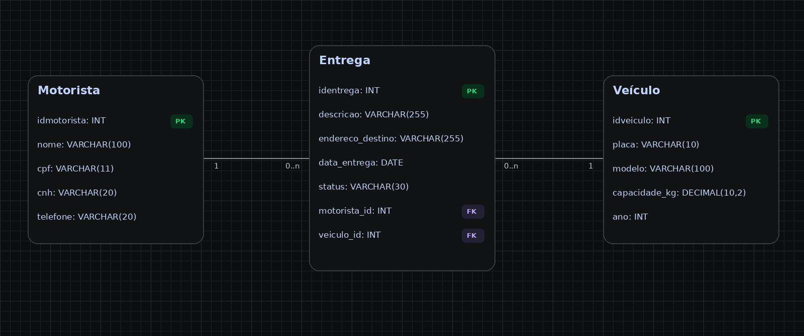

# logitrack-api
API RESTful para gerenciamento de motoristas, veículos e entregas

## Tecnologias utilizadas

- Node.js — Ambiente de execução JavaScript
- TypeScript — Linguagem utilizada no backend
- Fastify — Framework para desenvolvimento da API REST
- PostgreSQL — Banco de dados (integração prevista para E2)
- Git e GitHub — Versionamento e colaboração

## Estrutura do projeto

- `src/config` — Configurações
- `src/controllers` — Controle das requisições HTTP
- `src/services` — Regras de negócio
- `src/repositories` — Acesso ao banco de dados
- `src/routes` — Definição dos endpoints
- `src/dtos` — Objetos de entrada e saída

## Como executar

### Instalar dependências
npm install

### Iniciar servidor
npm run dev

### Compilar projeto
npm run build

## Endpoint inicial

GET http://localhost:3333/

Resposta:
{
  "status": "ok",
  "message": "LogiTrack API funcionando!"
}

## Descrição do problema

Uma empresa de entregas precisa organizar os dados de seus motoristas, veículos e entregas. Sem um sistema, fica difícil controlar essas informações.

## Solução proposta

Criar uma API RESTful para gerenciar motoristas, veículos e entregas, permitindo cadastrar, consultar, atualizar e excluir os dados.

## Entidades do sistema

### Motorista
Armazena as informações dos motoristas responsáveis pelas entregas.

- idmotorista: Identificador do motorista (PK).
- nome: Nome do motorista.
- cpf: CPF do motorista.
- cnh: Número da CNH.
- telefone: Telefone de contato.

### Veículo
Armazena os dados dos veículos utilizados nas entregas.

- idveiculo: Identificador do veículo (PK).
- placa: Placa do veículo.
- modelo: Modelo do veículo.
- capacidade_kg: Capacidade de carga em quilos.
- ano: Ano do veículo.

### Entrega
Armazena as informações de cada entrega realizada.

- identrega: Identificador da entrega (PK).
- descricao: Descrição da entrega.
- endereco_destino: Endereço de destino.
- data_entrega: Data da entrega.
- status: Situação da entrega.
- motorista_id: Identificador do motorista (FK).
- veiculo_id: Identificador do veículo (FK).

## Relacionamentos

- Motorista 1:N Entrega: Um motorista pode realizar várias entregas.
- Veículo 1:N Entrega: Um veículo pode ser utilizado em várias entregas.
- Cada entrega está vinculada a um motorista e a um veículo.

## Diagrama UML

## Integrantes e Responsabilidades

*Eduardo Moraes*
- Configuração inicial do projeto e do ambiente de desenvolvimento.
- Implementação do servidor HTTP com TypeScript e Fastify.
- Organização da arquitetura inicial do backend.
- Desenvolvimento dos módulos de Motoristas e parte de Entregas nas próximas etapas.

*Arthur Maciel*
- Definição do domínio e modelagem das entidades.
- Elaboração do diagrama UML e dos relacionamentos.
- Documentação do projeto no README.
- Desenvolvimento dos módulos de Veículos e parte de Entregas nas próximas etapas.

*Responsabilidades compartilhadas*
- Integração dos módulos da API.
- Testes, validações e correções.
- Implementação da carta-desafio.
- Revisão de código e Pull Requests.
- Preparação da apresentação final.