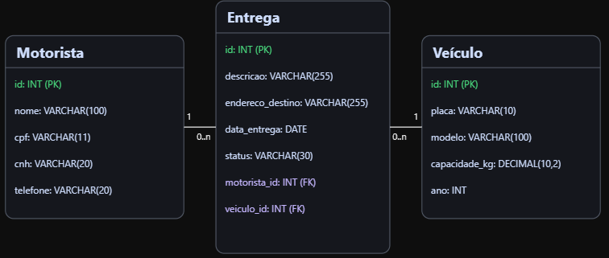

# LogiTrack API

API RESTful para gerenciamento de motoristas, veículos e entregas, desenvolvida para a avaliação E2.

## Tecnologias utilizadas

- Node.js
- TypeScript
- Fastify
- PostgreSQL
- Zod
- Docker
- Docker Compose
- Git e GitHub

## Descrição do problema

Uma empresa de entregas precisa organizar os dados de seus motoristas, veículos e entregas. Sem um sistema, fica difícil controlar essas informações e acompanhar a situação das entregas.

## Solução proposta

Desenvolver uma API RESTful integrada ao PostgreSQL, permitindo cadastrar, consultar, atualizar e excluir motoristas, veículos e entregas, com validações e regras de negócio.

## Estrutura do projeto

- `src/config` — Configuração do banco de dados.
- `src/controllers` — Controle das requisições HTTP.
- `src/services` — Regras de negócio.
- `src/repositories` — Acesso ao banco de dados.
- `src/routes` — Definição dos endpoints.
- `src/dtos` — Objetos de transferência e validação dos dados.
- `src/errors` — Tratamento de erros.
- `database` — Scripts SQL.
- `docs` — Documentação do projeto.

## Arquitetura

A aplicação utiliza uma arquitetura em camadas:

Routes → Controller → Service → Repository → PostgreSQL

Essa organização facilita a manutenção, a separação das responsabilidades e os testes da aplicação.

## Entidades do sistema

### Motorista

- id: Identificador do motorista (PK).
- nome: Nome do motorista.
- cpf: CPF do motorista.
- cnh: Número da CNH.
- telefone: Telefone de contato.

### Veículo

- id: Identificador do veículo (PK).
- placa: Placa do veículo.
- modelo: Modelo do veículo.
- capacidade_kg: Capacidade de carga em quilos.
- ano: Ano do veículo.

### Entrega

- id: Identificador da entrega (PK).
- descricao: Descrição da entrega.
- endereco_destino: Endereço de destino.
- data_entrega: Data da entrega.
- status: Situação da entrega.
- motorista_id: Identificador do motorista (FK).
- veiculo_id: Identificador do veículo (FK).

## Relacionamentos

- Motorista 1:N Entrega.
- Veículo 1:N Entrega.
- Um motorista pode realizar várias entregas.
- Um veículo pode ser utilizado em várias entregas.
- Cada entrega está vinculada a um motorista e um veículo.

## Diagrama UML



## Como executar

### Pré-requisitos

- Node.js
- Docker Desktop
- Git

### Configuração do ambiente

Copiar o arquivo `.env.example` para `.env` e configurar as variáveis de ambiente, principalmente a senha do PostgreSQL.

### Instalar dependências

```bash
npm install
```

### Executar com Docker Compose

```bash
docker compose up -d --build
```

### Verificar os containers

```bash
docker compose ps
```

### Compilar o projeto

```bash
npm run build
```

### Encerrar os containers

```bash
docker compose down
```

A API estará disponível em:

http://localhost:3333

## Verificação da conexão com o banco

GET /health/database

Resposta esperada:

```json
{
  "status": "ok",
  "message": "PostgreSQL conectado com sucesso!"
}
```

## Endpoints de Motoristas

| Método | Endpoint | Descrição |
|--------|----------|-----------|
| GET | /motoristas | Listar motoristas |
| GET | /motoristas/:id | Buscar motorista |
| POST | /motoristas | Cadastrar motorista |
| PUT | /motoristas/:id | Atualizar motorista |
| DELETE | /motoristas/:id | Excluir motorista |

### Exemplo de cadastro — DTO

```json
{
  "nome": "Motorista Teste",
  "cpf": "12345678901",
  "cnh": "12345678901",
  "telefone": "48999999999"
}
```

### Validações

- Nome obrigatório.
- CPF com 11 dígitos.
- CNH obrigatória.
- CPF e CNH não podem ser duplicados.
- Motoristas com entregas vinculadas não podem ser excluídos.

### Filtros e ordenação

```http
GET /motoristas?page=1&limit=10
GET /motoristas?nome=Teste
GET /motoristas?sortBy=nome&order=asc
```

## Endpoints de Veículos

| Método | Endpoint | Descrição |
|--------|----------|-----------|
| GET | /veiculos | Listar veículos |
| GET | /veiculos/:id | Buscar veículo |
| POST | /veiculos | Cadastrar veículo |
| PUT | /veiculos/:id | Atualizar veículo |
| DELETE | /veiculos/:id | Excluir veículo |

### Exemplo de cadastro — DTO

```json
{
  "placa": "ABC1D23",
  "modelo": "Volkswagen Gol G6",
  "capacidade_kg": 500,
  "ano": 2013
}
```

### Validações

- Placa obrigatória e única.
- Aceita placas antigas e padrão Mercosul.
- Exemplos: ABC1234 e ABC1D23.
- Modelo obrigatório.
- Capacidade de carga positiva.
- Ano entre 1900 e 2100.
- Veículos com entregas vinculadas não podem ser excluídos.

### Filtros e ordenação

```http
GET /veiculos?page=1&limit=10
GET /veiculos?modelo=Gol
GET /veiculos?placa=ABC1D23
GET /veiculos?sortBy=ano&order=desc
```

## Endpoints de Entregas

| Método | Endpoint | Descrição |
|--------|----------|-----------|
| GET | /entregas | Listar entregas |
| GET | /entregas/:id | Buscar entrega |
| POST | /entregas | Cadastrar entrega |
| PUT | /entregas/:id | Atualizar entrega |
| DELETE | /entregas/:id | Excluir entrega |

### Exemplo de cadastro — DTO

```json
{
  "descricao": "Entrega de mercadorias",
  "endereco_destino": "Criciuma SC",
  "data_entrega": "2026-11-30",
  "status": "PENDENTE",
  "motorista_id": 1,
  "veiculo_id": 1
}
```

### Status permitidos

- PENDENTE
- EM_TRANSITO
- ENTREGUE
- CANCELADA

### Validações

- Descrição obrigatória.
- Endereço de destino obrigatório.
- Data válida no formato YYYY-MM-DD, quando informada.
- Status pertencente aos valores permitidos.
- Motorista e veículo devem existir no banco.
- Os relacionamentos são protegidos pelas chaves estrangeiras.
- O status padrão é PENDENTE.

### Filtros e ordenação

```http
GET /entregas?page=1&limit=10
GET /entregas?status=PENDENTE
GET /entregas?motorista_id=1
GET /entregas?veiculo_id=1
GET /entregas?sortBy=data_entrega&order=desc
```

## Paginação

As rotas de listagem utilizam os seguintes parâmetros:

- page: Número da página, começando em 1.
- limit: Quantidade de registros por página, entre 1 e 100.
- sortBy: Campo utilizado para ordenação.
- order: Ordem crescente (asc) ou decrescente (desc).

### Campos disponíveis para ordenação

| Entidade | Campos |
|----------|--------|
| Motoristas | id, nome |
| Veículos | id, placa, modelo, capacidade_kg, ano |
| Entregas | id, data_entrega, status |

### Exemplo de resposta paginada

```json
{
  "data": [
    {
      "id": 1,
      "descricao": "Entrega Teste",
      "endereco_destino": "Endereco Teste",
      "data_entrega": null,
      "status": "PENDENTE",
      "motorista_id": 1,
      "veiculo_id": 1
    }
  ],
  "pagination": {
    "page": 1,
    "limit": 10,
    "total": 1,
    "totalPages": 1
  }
}
```

## Códigos HTTP

| Código | Descrição |
|--------|-----------|
| 200 | Operação realizada com sucesso |
| 201 | Registro criado com sucesso |
| 204 | Registro excluído com sucesso |
| 400 | Dados de entrada inválidos |
| 404 | Registro não encontrado |
| 409 | Conflito ou violação de integridade referencial |
| 422 | Violação de regra de negócio |
| 500 | Erro interno do servidor |
| 503 | Banco de dados indisponível |

## Testes realizados

- Testes do CRUD de Veículos.
- Testes dos cinco endpoints HTTP de Entregas.
- Validação de registros duplicados em Veículos.
- Testes de paginação, filtros e ordenação de Veículos.
- Testes de integridade referencial de Veículos.
- Conexão com PostgreSQL.
- Execução dos containers pelo Docker Compose.
- Compilação TypeScript sem erros.

### Resultado dos testes HTTP de Entregas

| Operação | Resultado |
|----------|-----------|
| Listar entregas | 200 OK |
| Buscar por ID | 200 OK |
| Cadastrar entrega | 201 Created |
| Atualizar entrega | 200 OK |
| Excluir entrega | 204 No Content |

## Integrantes e Responsabilidades

### Eduardo Samuel Barbosa de Moraes

- Configuração inicial do projeto.
- Configuração do PostgreSQL e Docker Compose.
- Desenvolvimento do CRUD de Motoristas.
- Implementação do tratamento global de erros.
- Desenvolvimento da implementação final de Entregas.
- Ajustes na validação de placas.

### Arthur Marcelino Maciel

- Modelagem das entidades.
- Elaboração do diagrama UML.
- Desenvolvimento do CRUD de Veículos.
- Implementação das regras de negócio de Veículos.
- Desenvolvimento e testes de uma implementação inicial de Entregas.
- Revisão e testes da implementação final de Entregas.
- Documentação do projeto.

### Responsabilidades compartilhadas

- Integração dos módulos.
- Revisão de código.
- Testes e validações.
- Organização dos Pull Requests.
- Preparação da entrega final.